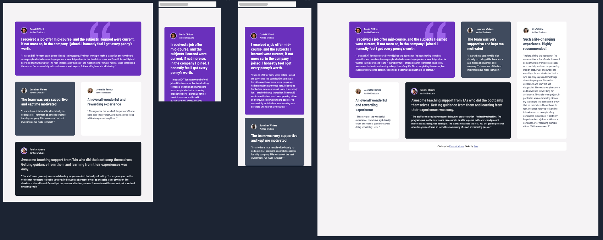

# Frontend Mentor - Testimonials grid section solution

This is a solution to the [Testimonials grid section challenge on Frontend Mentor](https://www.frontendmentor.io/challenges/testimonials-grid-section-Nnw6J7Un7). Frontend Mentor challenges help you improve your coding skills by building realistic projects. 

## Table of contents

- [Overview](#overview)
  - [The challenge](#the-challenge)
  - [Screenshot](#screenshot)
  - [Links](#links)
- [My process](#my-process)
  - [Built with](#built-with)
  - [What I learned](#what-i-learned)
  - [Continued development](#continued-development)
  - [AI Collaboration](#ai-collaboration)
- [Author](#author)

## Overview

### The challenge

Users should be able to:

- View the optimal layout for the site depending on their device's screen size

### Screenshot

### Links

- Solution URL: [GitHub repository](https://github.com/RoomForEpsilon/testimonials-grid-section)
- Live Site URL: [Live site](https://roomforepsilon.github.io/testimonials-grid-section/)

## My process

### Built with

- Semantic HTML5 markup
- CSS custom properties
- Flexbox
- CSS Grid
- Mobile-first workflow

### What I learned

This is my second project working with CSS Grid.  Styling things is going much more smoothly than it used to.  I think I'm getting good enough to try some challenges.

This project helped me to learn a little more about positioning background images.  Adding the quote image to the card helped me realize that a background image doesn’t have to fill the entire background. Since I’ve been getting used to positioning other elements, positioning the image was quick and easy.

I'm trying to get better with the commit score of the AI review, and I think I did a good job of remembering to commit and push after making changes.  It also helped that I finished the mobile, tablet, and desktop styles all in one day, so I remembered to commit them and move on to a new branch.

### Continued development

I think I'm ready to focus on some challenges, although I also want to incorporate JavaScript and learn React.

### AI Collaboration

I used ChatGPT for debugging.  I also had it copy the styles I made for one card to the other cards, so I could cut down on the time I spent working on them.  That was a good productivity booster while not just handing over the decision-making to the AI.

## Author

- Frontend Mentor - [@RoomForEpsilon](https://www.frontendmentor.io/profile/RoomForEpsilon)

